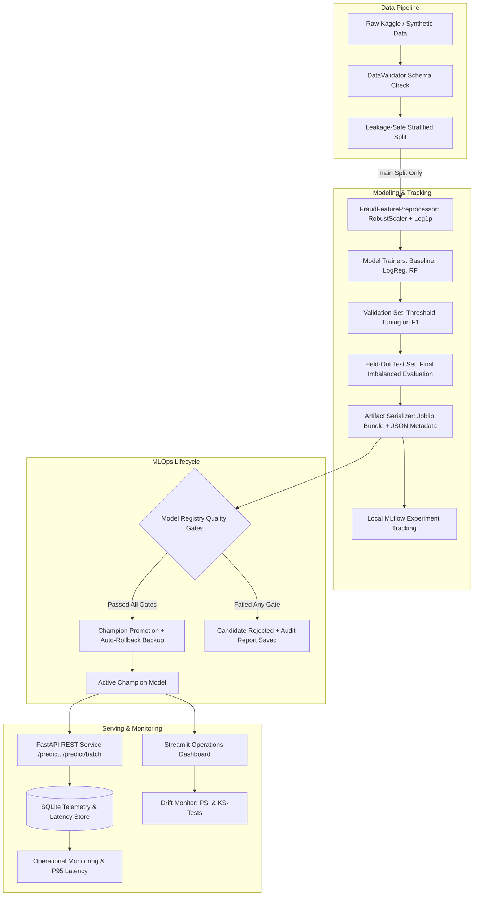

# FraudGuard AI — End-to-End Credit Card Fraud Detection & MLOps Platform

[](https://github.com/conbott/Fraud-Guard-AI/actions/workflows/ci.yml)
[](https://conbott-fraudguard.streamlit.app)
[](https://www.python.org/)
[](https://opensource.org/licenses/MIT)
[](https://github.com/astral-sh/ruff)
[](https://fastapi.tiangolo.com)
[](https://streamlit.io)

FraudGuard AI is an end-to-end credit card fraud detection and MLOps portfolio platform demonstrating data validation, model training and evaluation, experiment tracking, API-based inference, monitoring, and automated testing. Built natively for Windows and Linux without requiring Docker, WSL2, or paid cloud APIs, it demonstrates the full lifecycle: schema validation, leakage-safe feature engineering, baseline comparisons, imbalanced metrics (PR-AUC, Recall), decision threshold tuning, local MLflow experiment tracking, candidate quality gates, champion promotion, automated rollback, FastAPI serving, Streamlit operations dashboard, drift monitoring (PSI & KS-tests), and GitHub Actions CI/CD.

---

## Problem Statement & Motivation
Credit card fraud costs global payment networks tens of billions of dollars annually. Building machine learning systems for financial fraud presents distinct challenges:
1. **Extreme Class Imbalance:** Legitimate transactions account for over 99.8% of volume. Conventional accuracy is a deceptive metric—a model predicting all zeros achieves 99.83% accuracy while catching zero frauds.
2. **Asymmetric Error Costs:** False negatives (missing a fraud) directly result in financial loss; false positives (blocking a legitimate customer card) cause customer churn and operational overhead.
3. **Data Leakage Vulnerability:** Standard scalers and threshold selections often leak validation statistics into training, producing falsely optimistic metrics.
4. **Distribution Shift (Drift):** Consumer spending surges (e.g. holidays) and adversary evasion strategies cause input features to drift over time.

FraudGuard AI solves these challenges with a rigorous, verified MLOps architecture.

---

## System Architecture & Workflow



---

## Benchmark Evaluation Results (Real MLG-ULB Dataset, 284,807 Transactions)

The MLG-ULB Credit Card Fraud Detection dataset contains 284,807 transactions with 492 fraud cases (0.1727% prevalence). All models are evaluated with decision thresholds tuned strictly on the validation partition to optimize F1-score without evaluation leakage.

### 1. Stratified Partitioning (60% Train: 170,883 | 20% Val: 56,962 | 20% Held-Out Test: 56,962)
| Classifier Model | Tuned Threshold | Val PR-AUC | Val F1 | Test PR-AUC | Test ROC-AUC | Test Precision | Test Recall | Test F1-Score | False Positive Rate | Test TP / FP / TN / FN |
|---|---|---|---|---|---|---|---|---|---|---|
| **Dummy Baseline (Stratified)** | 0.05 | 0.0017 | 0.0000 | 0.0017 | 0.4992 | 0.0000 | 0.0000 | 0.0000 | 0.001635 | 0 / 93 / 56,771 / 98 |
| **Logistic Regression (`balanced`)** | 0.95 | 0.6761 | 0.4233 | 0.7168 | 0.9724 | 0.3000 | 0.8878 | 0.4485 | 0.003570 | 87 / 203 / 56,661 / 11 |
| **Random Forest (Active Champion)** | 0.43 | **0.7693** | **0.8280** | **0.8140** | **0.9717** | **0.8081** | **0.8163** | **0.8122** | **0.000334** | **80 / 19 / 56,845 / 18** |

### 2. Chronological Partitioning (Ordered by `Time`: First 60% Train | Middle 20% Val | Final 20% Test)
| Classifier Model | Tuned Threshold | Val PR-AUC | Val F1 | Test PR-AUC | Test ROC-AUC | Test Precision | Test Recall | Test F1-Score | False Positive Rate | Test TP / FP / TN / FN |
|---|---|---|---|---|---|---|---|---|---|---|
| **Dummy Baseline (Stratified)** | 0.05 | 0.0010 | 0.0000 | 0.0013 | 0.4990 | 0.0000 | 0.0000 | 0.0000 | 0.002039 | 0 / 116 / 56,770 / 75 |
| **Logistic Regression (`balanced`)** | 0.95 | 0.7511 | 0.3498 | 0.7442 | 0.9817 | 0.3520 | 0.8400 | 0.4961 | 0.002039 | 63 / 116 / 56,770 / 12 |
| **Random Forest** | 0.34 | **0.7508** | **0.8350** | **0.8151** | **0.9547** | **0.8906** | **0.7600** | **0.8201** | **0.000123** | **57 / 7 / 56,879 / 18** |

### Split Trade-offs & Empirical Analysis:
- **Stratified Split:** Preserves exact positive class prevalence (0.1727%) uniformly across all three partitions. Random Forest achieves balanced test precision (80.81%) and recall (81.63%), producing only 19 false alarms across 56,864 transactions (FPR = 0.033%).
- **Chronological Split:** Reflects realistic deployment where models are trained on past data and evaluated on future transactions. In the chronological split, fraud prevalence shifts from 0.2107% in training to 0.1001% in validation and 0.1317% in the test window. Random Forest achieves 89.06% precision with 76.00% recall and only 7 false alarms across 56,886 test transactions (FPR = 0.012%), confirming resilience to temporal distribution shifts.

---

## Advanced Offline Experiment: IEEE-CIS Fraud Detection
In addition to the MLG-ULB baseline, FraudGuard AI includes a standalone experimentation pipeline for the complex [IEEE-CIS Fraud Detection dataset](https://www.kaggle.com/competitions/ieee-fraud-detection).
- **Scale & Feature Schema:** 590,540 transactions across 434 columns (card identifiers, transaction amounts, device types, identity metadata, and interaction tallies).
- **Architecture Separation:** Kept strictly offline in `scripts/run_ieee_cis_experiment.py` to prevent memory exhaustion (OOM) and preserve the lightweight, responsive Streamlit cloud application.
- **Memory Safeguards:** Implements explicit float32/int32 downcasting and categorical frequency encoding, reducing RAM consumption from ~8-12 GB to under 2.5 GB.
- **Temporal Evaluation:** Official competition test set is unlabeled. Internal evaluation is performed via chronological hold-out splitting on `TransactionDT`.
- **Run Pipeline:**
  ```powershell
  # Specifications & verification (synthetic IEEE-CIS schema):
  python scripts/run_ieee_cis_experiment.py --mock

  # Full run on raw Kaggle files (placed in data/raw/ieee_cis/):
  python scripts/run_ieee_cis_experiment.py --max-rows 100000
  ```

---

## Technology Stack
- **Core ML:** Python 3.11+, Scikit-Learn 1.4+, pandas, NumPy, SciPy, Joblib
- **API & Serving:** FastAPI, Uvicorn, Pydantic V2, HTTPX
- **Dashboard UI:** Streamlit, Matplotlib, Seaborn
- **Experiment Tracking:** MLflow (local file-based tracking)
- **Monitoring:** Population Stability Index (PSI), Kolmogorov-Smirnov 2-sample tests, SQLite audit telemetry
- **Code Quality & CI:** Pytest, Pytest-Cov, Ruff, GitHub Actions CI
- **Constraints Compliance:** Zero paid APIs, no billing activation, no Docker/WSL2, Windows-native development

---

## Quickstart Guide (PowerShell / Windows)

### 1. Prerequisites Check
Verify Python 3.11+ and Git are installed:
```powershell
python --version
git --version
```

### 2. Set Up Dependencies
```powershell
# Upgrade pip and install all production & dev dependencies
python -m pip install --upgrade pip
python -m pip install -r requirements-dev.txt
```

### 3. Generate Test Fixtures & Initial Champion Model
```powershell
# Create reproducible synthetic datasets in data/synthetic/
python scripts/generate_synthetic_data.py --create-fixtures

# Train baseline, logistic regression, and random forest models; promote champion
python scripts/train.py --champion
```

### 4. Run Automated Test Suite (33 Tests, 100% Pass)
```powershell
python -m pytest tests/ -v --cov=src --cov-report=term-missing
```

### 5. Launch the FastAPI Prediction Service
```powershell
python -m uvicorn src.api.app:app --host 127.0.0.1 --port 8000
```
- Interactive OpenAPI Docs: [http://localhost:8000/docs](http://localhost:8000/docs)
- Health Check: [http://localhost:8000/health](http://localhost:8000/health)

### 6. Launch the Streamlit Interactive Dashboard
- **Live Cloud Deployment:** [https://conbott-fraudguard.streamlit.app](https://conbott-fraudguard.streamlit.app)
- **Local Dashboard:**
```powershell
python -m streamlit run app.py
```
- Access local dashboard at: [http://localhost:8501](http://localhost:8501)

### 7. Launch Local MLflow Experiment UI
```powershell
python -m mlflow ui --port 5000
```
- Access local experiment tracking at: [http://localhost:5000](http://localhost:5000)

---

## REST API Examples

### Single Transaction Scoring (`POST /predict`)
```powershell
Invoke-RestMethod -Uri "http://127.0.0.1:8000/predict" -Method Post -ContentType "application/json" -Body '{
  "Time": 406.0,
  "Amount": 149.62,
  "V1": -2.31, "V2": 1.95, "V3": -1.61, "V4": 3.99, "V5": -0.52,
  "V6": -1.43, "V7": -2.54, "V8": 1.56, "V9": -2.77, "V10": -2.77,
  "V11": 3.20, "V12": -2.90, "V13": -0.59, "V14": -4.28, "V15": 0.39,
  "V16": -1.14, "V17": -2.83, "V18": -0.01, "V19": 0.42, "V20": 0.13,
  "V21": 0.52, "V22": -0.03, "V23": -0.47, "V24": 0.32, "V25": 0.04,
  "V26": 0.18, "V27": 0.26, "V28": -0.14
}'
```

**Response Example:**
```json
{
  "request_id": "a931405c-373a-4ddc-87d4-8ceb85ce48fa",
  "is_fraud": true,
  "risk_score": 0.9421,
  "decision_threshold": 0.7100,
  "risk_level": "HIGH",
  "model_version": "model_v20261017_135912",
  "algorithm": "logistic_regression",
  "latency_ms": 4.12,
  "cautionary_notice": "Statistical risk estimate only. This prediction is not a verified legal or financial determination of fraud..."
}
```

---

## Model Registry, Retraining & Rollback Workflow

FraudGuard AI enforces quality gating before any retrained candidate model can replace the active Champion:

```powershell
# 1. Run Automated Retraining & Quality Gating
python scripts/retrain.py --data-path data/synthetic/synthetic_transactions.csv --reason "Monthly automated retraining"

# 2. Emergency Rollback to Prior Champion
python scripts/retrain.py --rollback
```

### Production Quality Gates:
- **Minimum PR-AUC:** $\ge 0.70$
- **Minimum Recall:** $\ge 0.75$
- **Minimum Precision:** $\ge 0.60$
- **Maximum False Positive Rate:** $\le 0.02$
- **Champion Benchmark:** Must not degrade PR-AUC compared to active champion ($\Delta\text{PR-AUC} \ge -0.01$).

---

## Feature & Prediction Drift Monitoring

Detect statistical distribution shift between production transaction streams and training baseline features:
```powershell
# Run drift monitoring with synthetic amount inflation simulation
python scripts/run_monitoring.py --data-path data/synthetic/synthetic_transactions.csv --simulate-drift amount_spike
```

Sample output:
```
=================================================================
FRAUDGUARD AI - DRIFT MONITORING REPORT
=================================================================
Overall Drift Status : CRITICAL_DRIFT
Reference Samples    : 1,920
Current Samples      : 3,000
Drifted Features     : 2 / 9
-----------------------------------------------------------------
Feature    | PSI      | KS p-val   | Status            
-----------------------------------------------------------------
Amount     | 0.4821   | 0.000000   | SIGNIFICANT_DRIFT 
V1         | 0.0124   | 0.421890   | NO_DRIFT          
V14        | 0.0210   | 0.284711   | NO_DRIFT          
-----------------------------------------------------------------
PREDICTION DRIFT SUMMARY:
 - Mean Risk Score   : 0.1420
 - P95 Risk Score    : 0.8912
 - High-Risk Pct     : 8.5%
```

---

## Free Cloud Deployment (Streamlit Community Cloud)

1. Push this repository to your personal public GitHub account.
2. Sign in to [share.streamlit.io](https://share.streamlit.io/) with your GitHub account. *(No credit card or billing account required!)*
3. Select this repository and set **Main file path:** `app.py`.
4. Click **Deploy!** Your app will be live on `https://<your-app>.streamlit.app`.

---

## Repository Structure
```
FraudGuard-AI/
├── .github/workflows/ci.yml         # GitHub Actions CI workflow
├── configs/
│   ├── model_config.yaml            # Pipeline schema, models, split, quality gates
│   └── monitoring_config.yaml       # Drift thresholds, PSI settings, feature lists
├── data/
│   ├── README.md                    # Kaggle dataset instructions & privacy policy
│   ├── raw/                         # Raw creditcard.csv (git-ignored)
│   ├── processed/                   # Reference features Parquet (git-ignored)
│   └── synthetic/                   # Test fixtures (test_fixture.csv)
├── docs/
│   ├── architecture.md              # System design and component diagrams
│   ├── data_dictionary.md           # Attribute descriptions and PCA component details
│   ├── model_card.md                # Intended use, metrics, and bias limitations
│   ├── deployment.md                # Streamlit Cloud & AWS/Azure migration guide
│   ├── testing.md                   # QA test suite and execution instructions
│   ├── security.md                  # PII protection and safe deserialization
│   ├── retraining.md                # Quality gates, promotion, and rollback guide
│   ├── troubleshooting.md           # Windows PowerShell FAQ and error solutions
│   └── interview_guide.md           # Portfolio technical Q&A for MLOps interviews
├── models/
│   ├── README.md                    # Model artifact and registry documentation
│   ├── champion/                    # Active champion model.joblib & metadata.json
│   ├── candidates/                  # Versioned candidate models
│   └── reports/                     # Quality gate and drift JSON audits
├── scripts/
│   ├── generate_synthetic_data.py   # Test fixture generation CLI
│   ├── validate_data.py             # Schema & data quality validation CLI
│   ├── train.py                     # Model comparison & training CLI
│   ├── evaluate_experiments.py      # Multi-split benchmark evaluation CLI
│   ├── run_ieee_cis_experiment.py   # Standalone IEEE-CIS experiment CLI
│   ├── run_monitoring.py            # Drift detection & PSI calculation CLI
│   └── retrain.py                   # Automated retraining, promotion, and rollback CLI
├── src/
│   ├── __init__.py
│   ├── config.py                    # YAML configuration loader with dataclasses
│   ├── data/
│   │   ├── loader.py                # Leakage-safe stratified & chronological dataset splitting
│   │   ├── validator.py             # Schema, type, null, inf, and duplicate validator
│   │   └── synthetic.py             # Synthetic transaction mathematical generator
│   ├── features/
│   │   └── preprocessor.py          # RobustScaler & log1p feature preprocessor
│   ├── training/
│   │   ├── train.py                 # Multi-model training and threshold tuning
│   │   ├── evaluate.py              # PR-AUC, ROC-AUC, confusion matrix, and curves
│   │   ├── tracking.py              # Local MLflow experiment tracker
│   │   └── registry.py              # Model registry, quality gates, and rollback
│   ├── inference/
│   │   ├── loader.py                # Safe Joblib artifact loader & schema checker
│   │   └── predictor.py             # Calibrated risk prediction engine
│   ├── monitoring/
│   │   ├── drift.py                 # Population Stability Index & KS-test monitor
│   │   └── metrics.py               # SQLite inference telemetry audit store
│   ├── api/
│   │   ├── app.py                   # FastAPI application factory
│   │   ├── routes.py                # Endpoints (/health, /predict, /batch, /metrics)
│   │   └── schemas.py               # Strict Pydantic V2 request & response schemas
│   └── dashboard/
│       └── app.py                   # Full 7-page interactive Streamlit dashboard
├── tests/
│   ├── conftest.py                  # Pytest fixtures
│   ├── unit/                        # 25 unit tests
│   └── integration/                 # 8 API integration tests
├── .gitignore                       # Strict ignore rules for data, models, and cache
├── app.py                           # Root entrypoint for Streamlit Community Cloud
├── pyproject.toml                   # Project metadata, pytest, and ruff configs
├── requirements.txt                 # Production dependencies
├── requirements-dev.txt             # Development, testing, and linting dependencies
└── LICENSE                          # MIT License
```

---

## Security & Data Privacy
- **Zero Raw Financial Data Committed:** Credit card numbers, CVVs, cardholder names, and bank credentials are completely excluded.
- **Joblib Deserialization Hardening:** `ModelLoader` strictly validates internal dictionary structures and rejects arbitrary user-uploaded pickle files.
- **API Defense:** Strict Pydantic schemas forbid unexpected extra attributes.

---

## License & Attribution
- Project code licensed under the [MIT License](LICENSE).
- Dataset attribution: Machine Learning Group (ULB) on European cardholders (September 2013).
