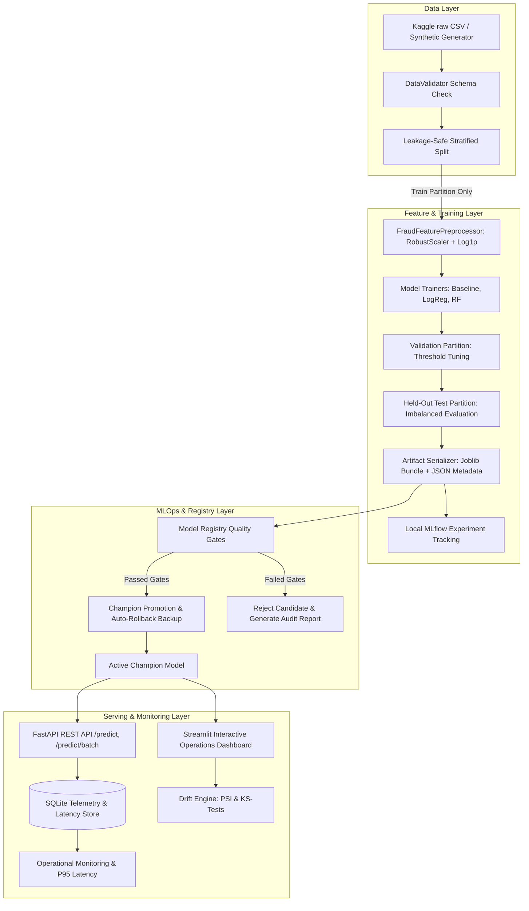

# FraudGuard AI — System Architecture

## Architecture Overview

FraudGuard AI is designed as a modular, production-grade MLOps system built with Python 3.11+, scikit-learn, FastAPI, Streamlit, and local MLflow tracking. It runs 100% natively on Windows and Linux without requiring local Docker, Kubernetes, or paid cloud services.

---

## Component Architecture

### 1. Data Ingestion & Validation (`src/data/`)
- **`validator.py`**: Validates required columns (`Time`, `Amount`, `V1`..`V28`), data types, nulls, infs, negative values, and target labels. Produces structured machine-readable error and warning reports.
- **`loader.py`**: Performs stratified train/val/test splits strictly before any preprocessing to prevent leakage.
- **`synthetic.py`**: Generates mathematically sound synthetic fixtures for unit testing, CI smoke tests, and drift simulation.

### 2. Feature Engineering & Preprocessing (`src/features/`)
- **`preprocessor.py`**: Implements `FraudFeaturePreprocessor`.
  - Amount transformed via $\ln(1 + \max(\text{Amount}, 0))$ to normalize extreme skew.
  - Scaler (`RobustScaler`) fitted strictly on training data.
  - Transforms applied identically across single inferences, batch streams, and candidate retraining.

### 3. Model Training & Evaluation (`src/training/`)
- **`train.py`**: Trains baseline (dummy), logistic regression, and random forest. Evaluates each on validation partition.
- **`evaluate.py`**: Evaluates PR-AUC, ROC-AUC, Precision, Recall, F1, FPR, FNR. Tunes decision threshold strictly on the validation set.
- **`tracking.py`**: Tracks experiments locally with file-based MLflow (`mlruns/`), logging parameters, metrics, duration, and dataset SHA-256 fingerprints.
- **`registry.py`**: Manages candidate versioning, evaluates multi-metric quality gates, promotes champion, and provides instant rollback to the previous champion.

### 4. Serving & Inference (`src/api/` & `src/inference/`)
- **`loader.py`**: Securely loads only internally generated Joblib artifact bundles, verifying dictionary structure, preprocessor state, and metadata.
- **`predictor.py`**: Executes inference, compares calibrated risk probabilities against the tuned threshold, and assigns risk tiers (LOW, MEDIUM, HIGH).
- **`app.py` & `routes.py`**: FastAPI server exposing `/health`, `/model-info`, `/predict`, `/predict/batch`, and `/metrics`.

### 5. Drift Monitoring & Telemetry (`src/monitoring/`)
- **`drift.py`**: Computes Population Stability Index (PSI) and Kolmogorov-Smirnov 2-sample tests against baseline training features.
- **`metrics.py`**: Logs request IDs, timestamps, latencies, and risk scores into an embedded SQLite audit database (`predictions_audit.db`).

### 6. Interactive Dashboard (`src/dashboard/` & `app.py`)
- Full Streamlit dashboard with 7 modular views: Overview, Prediction, Evaluation, Data Quality, Drift Monitoring, Model Registry, and System Architecture.
- Standalone execution: connects directly to Python modules without requiring a running FastAPI or MLflow server.
