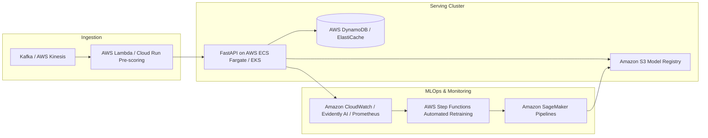

# FraudGuard AI — Cloud Deployment & Production Operations Guide

## Deployment Options

FraudGuard AI is designed to support zero-spending public deployment with 100% free hosting and no payment verification requirements.

---

## 1. Streamlit Community Cloud (Recommended Free Public Demo)

### Verification of Current Free-Tier Requirements
- **Cost:** 100% Free for public GitHub repositories.
- **Credit Card / Payment Verification Required?** **NO.** Streamlit Community Cloud does not require a billing account, credit card, or active subscription to host public open-source apps.
- **Resource Limits:** ~1 GB RAM per free container, 1 CPU core. The optimized FraudGuard champion model bundle is only ~1.5 MB in memory, well within free-tier limits.
- **Ephemeral Filesystem:** Cloud container storage is ephemeral. The application is designed to be fully self-contained without requiring persistent local SQLite databases or local MLflow servers to start.

### Step-by-Step Deployment Instructions:
1. **Push Code to GitHub:**
   - Initialize git and push this repository to your personal GitHub account (e.g., `https://github.com/<your-username>/FraudGuard-AI`).
   - Ensure the repository is set to **Public**.
2. **Sign In to Streamlit Community Cloud:**
   - Navigate to [share.streamlit.io](https://share.streamlit.io/).
   - Click **Continue with GitHub** to authenticate.
3. **Deploy the App:**
   - Click **Create App** (or **New app**).
   - Select your repository: `<your-username>/FraudGuard-AI`.
   - Set **Branch:** `main` (or `master`).
   - Set **Main file path:** `app.py`.
   - Click **Deploy!**
4. **Verification:**
   - The build log will install dependencies from `requirements.txt`.
   - Within 1–2 minutes, your interactive dashboard will be live at `https://<your-app-name>.streamlit.app`.

---

## 2. Local Windows-Native Execution (Zero Cloud Dependency)

No cloud access, virtualization, or Docker is required to run the full platform locally.

### Activate Virtual Environment:
```powershell
# Open PowerShell in the project directory
.\.venv\Scripts\Activate.ps1
```

### Launch Interactive Streamlit Dashboard:
```powershell
streamlit run app.py
```
*Access dashboard in your browser at `http://localhost:8501`.*

### Launch FastAPI Production REST API:
```powershell
uvicorn src.api.app:app --host 127.0.0.1 --port 8000 --reload
```
*Access OpenAPI documentation at `http://localhost:8000/docs`.*

### Launch Local MLflow Experiment UI:
```powershell
mlflow ui --backend-store-uri mlruns
```
*Access MLflow UI at `http://localhost:5000`.*

---

## 3. Enterprise Migration Design (AWS / Azure Blueprint)

While FraudGuard AI is implemented locally to adhere strictly to the zero-spending constraint, this enterprise migration architecture illustrates how it scales in a corporate cloud infrastructure:



### Key Differences in Enterprise Production:
1. **Containerization:** Package FastAPI and Streamlit into OCI containers using multi-stage builds.
2. **Model Registry:** Replace local Joblib file storage with an S3/GCS bucket managed via AWS SageMaker Model Registry or Databricks Managed MLflow.
3. **Distributed Serving:** Deploy FastAPI behind an Application Load Balancer with autoscaling pods on AWS ECS Fargate or Kubernetes.
4. **Real-time Feature Store:** Store real-time cardholder transaction frequency aggregations in Redis/Feast.
