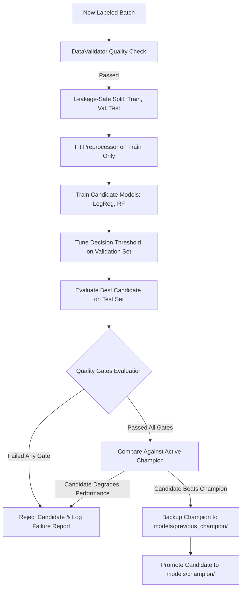

# FraudGuard AI — Retraining, Promotion & Rollback Guide

## Retraining Philosophy

In production fraud systems, **data drift alone should not trigger automatic model promotion**. 

Data drift ($P(X)$ change) indicates that transaction patterns or input distributions have shifted, but without ground-truth labels ($Y$), retrained models cannot be objectively scored. Retraining and model promotion MUST always require:
1. Validated labeled transaction batches ($X$ and $Y$).
2. Leakage-safe split into training, validation, and held-out test sets.
3. Multi-metric evaluation against production Quality Gates.
4. Benchmark comparison against the active Champion model.

---

## Retraining & Promotion Workflow



---

## Production Quality Gates

Before any candidate model can be promoted to Champion, it must strictly satisfy the following absolute and comparative gates:

| Quality Gate | Condition | Rationale |
|---|---|---|
| **Minimum PR-AUC** | $\text{PR-AUC} \ge 0.70$ | Ensures high precision-recall ranking across minority fraud cases. |
| **Minimum Recall** | $\text{Recall} \ge 0.75$ | Ensures at least 75% of fraudulent transactions are detected. |
| **Minimum Precision**| $\text{Precision} \ge 0.60$ | Keeps false alarms manageable for fraud investigation teams. |
| **Maximum FPR** | $\text{FPR} \le 0.02$ | Caps false positive rate at 2% to protect legitimate customer transactions. |
| **Champion Benchmark**| $\Delta\text{PR-AUC} \ge -0.01$ | Candidate must not degrade performance compared to current Champion. |

---

## CLI Execution Examples

### 1. Execute Automated Retraining & Promotion
```powershell
.\.venv\Scripts\python.exe scripts/retrain.py --data-path data/synthetic/synthetic_transactions.csv --reason "Monthly scheduled retraining batch"
```

### 2. Emergency Rollback to Previous Champion
If an unforeseen production anomaly occurs after a promotion, roll back immediately:
```powershell
.\.venv\Scripts\python.exe scripts/retrain.py --rollback
```
*This command restores `models/previous_champion/model.joblib` and `metadata.json` directly into `models/champion/` within seconds.*

### 3. Review Quality Gate Reports
All promotion evaluation audits are saved as JSON records in `models/reports/`:
```powershell
Get-ChildItem models/reports/
Get-Content models/reports/promotion_gate_*.json | ConvertFrom-Json
```
